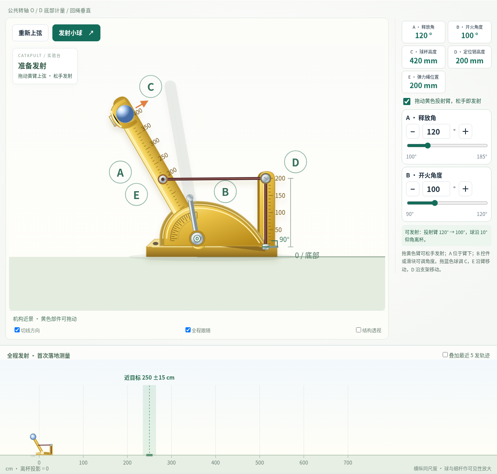

# 投射器 DOE · 紧凑竖直 D 支架版

[下载程序 ZIP](https://github.com/Future2025shenzhen/AI-SPC/archive/refs/heads/main.zip)

解压后，用 Chrome / Edge 打开 HTML，即可离线使用。中文优先使用电脑已安装的微软雅黑。

## 程序入口

`DOE_Catapult_Reference_Layout.html` 为推荐入口；`DOE_Catapult_Competition.html` 保留作为兼容文件名。两者现在都采用固定竖直的 D 支架，改变 B 只调限位角，不再让右臂倾斜。



[查看参考图姿态与新比例](preview-reference.png) · [查看连续发射](preview-flight.png) · [查看结构透视](preview-structure.png)

## 本轮优化

- D 支架向左靠近挡板，改为竖直平底，与底座直角连接。
- 支架总长 220 mm，顶部只比 200 刻度高 20 mm；D 范围仍为 0–200 mm。
- 底座右侧收短；底部灰色地面线的左半段移除，锚点导轨仅保留右段。
- C 上限与默认值均为 420 mm；默认释放角仍为 120°。
- 保留等大透明悬浮标识、无连线、拖臂发射、拖球调节、点击只上弦、三目标 ±15 cm 和 DOE。

D 的几何与锚点位置已同步到计算模型。教学弹性系数改为 36 N/m，以保持 70–700 cm 目标探索范围；不使用射程缩放。新旧几何的数据应分别分析。[当前物理参数与验证](PHYSICS_NOTES.md) · [参考来源](GITHUB_REFERENCES.md)。

## 操作

直接拖动黄色臂，松手即可发射。要只调位置，取消“拖动黄色投射臂，松手即发射”。A / B 也支持圆弧拖动、大滑块、数字输入与 ±1°；C / E 沿臂拖动，D 沿支架拖动。

| 变量 | 范围 |
|---|---|
| A 释放角 | 100–185° |
| B 开火角度 | 90–120° |
| C 球杯位置 | 200–420 mm |
| D 距支架底部的销位置 | 0–200 mm |
| E 绳挂点位置 | 100–200 mm |

D 的测量零点是 0，可调区间为 0–200 mm。A 不能低于 B；A=B 时尚未上弦。调整限位 B 时尚未上弦的臂随限位移动。

## 三目标与 DOE

近 / 中 / 远默认 250 / 300 / 425 cm，可以设置 70–700 cm 内的递增目标。公差 **±15 cm，含上下边界**。实际落点按物理模型计算，不强制裁剪至目标范围。

探索和确认验证分开记录。确认默认连续 10 次，可设 2–30 次；锁定参数和目标，支持完成本发后停止。成绩只统计每个目标最近一组同设置验证，旧目标和历史设置不覆盖。

保留 PPT 教学路线：课堂三因子 A/C/D，B=110°、E=200 mm 固定；19 次全因子加中心点；25 次表面中心设计；效应、交互、响应拟合、三个目标的建议设置以及独立确认验证。也保留五因子全因子与半分数。

物理假设和验证见 [PHYSICS_NOTES.md](PHYSICS_NOTES.md)。程序是明确假设下的教学模型，图形独立重绘，不是原设备的标定数字孪生。

数据只保存在当前网页内存，刷新或关闭会清空，请及时导出。


## 开发验证

程序使用不依赖外部库的原生 HTML / SVG / Canvas，直接打开即可使用。开发测试可运行：

```sh
python -m pip install -r tests/requirements.txt
python -m playwright install chromium
python tests/test_physics.py
python tests/test_browser.py
python tests/test_follow_camera.py
python tests/test_ground_recock.py
python tests/test_arm_ball_ranges.py
python tests/test_coordinated_proportions.py
python tests/test_upright_reference.py
```

物理测试与独立 SciPy 高精度积分比较，并检查能量平衡；浏览器测试检查球杯位置、离杯连续性、静态 SVG 复用、回放数据完整性、落地后拉臂、目标切换及移动端宽度；跟随镜头测试检查离杯前后球心、每个飞行采样点是否在视野内、平滑变焦及透视操作不改变数据。若系统已安装 `chromium`，测试优先使用该浏览器。

移除桌面后射程会与旧版有所不同；旧版数据和新版数据请分别用于 DOE 分析。回放仍使用原发射轨迹，点击机身仅重新上弦；主动发射才增加一次试验。
